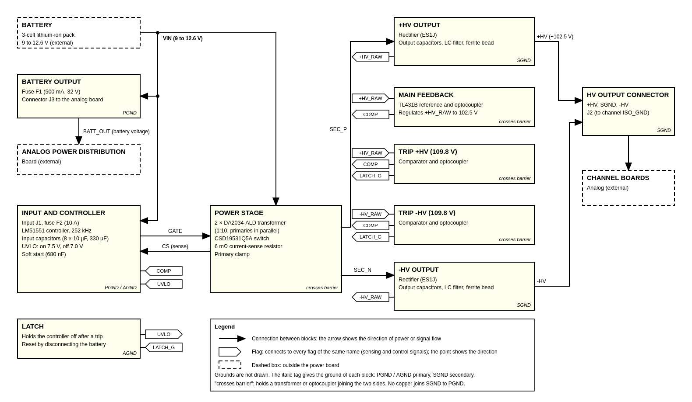

# STIM power board: current design

Status 27 Nov 2026. This file describes the schematic as it stands, block by block, using the **schematic's reference designators**. It replaces `FINAL_DESIGN_FOR_LAYOUT_2026-11-15.md` as the design reference; that file keeps the history and working names.

The design is verified by TI's calculator, LTspice and ngspice. Nothing has been built.

Tags: [DS] datasheet · [calc] TI calculator · [L] LTspice · [N] ngspice · [H] hand calculation · [ASSUME] assumption. Decision numbers (P-n) refer to the log in [`context/PROJECT_CONTEXT.md`](context/PROJECT_CONTEXT.md).

## Contents

1. [Summary](#1-summary)
2. [Block diagram and sheets](#2-block-diagram-and-sheets)
3. [Grounds and isolation](#3-grounds-and-isolation)
4. [Parts by sheet](#4-parts-by-sheet)
5. [Performance](#5-performance)
6. [Protection](#6-protection)
7. [Load budget](#7-load-budget)
8. [Layout rules](#8-layout-rules)
9. [Bench checklist](#9-bench-checklist)
10. [Open items](#10-open-items)

## 1. Summary

| Item | Value | Source |
|---|---|---|
| Input | 9 to 12.6 V, three-cell lithium-ion pack | P-8 |
| Regulated rail | +102.5 V | P-12 |
| Second rail | −HV follows +HV; at full load it sits 5 to 7 V closer to ground (−95.8 to −97.4 V) | P-17; [L] |
| Rated load | 171 mA per rail at 9 V input (16 channels at the 10 mA fault limit) | P-19 |
| Topology | One LM51551 (U1), one CSD19531Q5A switch (Q2), two DA2034-ALD transformers (T1, T2) with primaries in parallel | P-6 |
| Switching frequency | 252 kHz, continuous conduction | [calc] |
| Regulation | Secondary side: senses +HV_RAW directly | P-1 |
| Efficiency at 9 V, 171 mA per rail | 86.5 % (36.4 W in, 31.5 W out); battery current about 4.3 A | [L] |
| Ripple after the filter | 6 to 7 mV peak to peak | [L] |
| Protection | Trip at 109.8 V on either rail, latched off until the battery is disconnected; 16.2 A primary current limit | P-13; [calc] |
| Isolation | Functional only (1500 Vrms). SGND isolated from PGND | P-3, P-26 |

## 2. Block diagram and sheets

The top sheet `pcb/power_supply.kicad_sch` is the block diagram; each block is a sub-sheet joined through hierarchical pins.

| Sheet | File | Designators |
|---|---|---|
| INPUT AND CONTROLLER | `input_and_controller.kicad_sch` | J1, F2, C1–C14, R1–R5, Q1, U1, NT1 |
| POWER STAGE | `power_stage.kicad_sch` | T1, T2, Q2, R6–R11, C15, C16, D1 |
| +HV OUTPUT | `hv_pos_output.kicad_sch` | D2, D3, R12, R13, R54, R55, C17–C23, L1, FB1 |
| −HV OUTPUT | `hv_neg_output.kicad_sch` | D4, D5, R14, R15, R56, R57, C24–C30, L2, FB2 |
| MAIN FEEDBACK (+HV_RAW, 102.5 V) | `main_feedback.kicad_sch` | U2, U3, Q3, D6–D8, R16–R29, C31, C32 |
| TRIP +HV (109.8 V) | `trip_pos_hv.kicad_sch` | U4, U5, Q4, D9, R30–R40, C33 |
| TRIP −HV (109.8 V) | `trip_neg_hv.kicad_sch` | U6, U7, Q5, D10, R41–R51, C34 |
| LATCH | `latch.kicad_sch` | Q6, Q7, R52, R53, C35 |
| BATTERY OUTPUT (VIN) | `battery_output.kicad_sch` | F1, J3 |
| HV OUTPUT CONNECTOR | `hv_output_connector.kicad_sch` | J2 |
| TEST POINTS | `test_points.kicad_sch` | TP1–TP13 |

### Nets

| Net | Meaning |
|---|---|
| VIN | Battery positive, after F2 |
| PGND | Battery negative and primary power ground |
| AGND | Controller ground; joined to PGND at one point by net tie NT1 |
| SGND | HV return and midpoint of the two rails; isolated from PGND and AGND; goes to the channel board's ISO_GND through J2 |
| SW, SNS | Switch node; top of the sense resistor |
| CS, COMP, UVLO, VCC, SS, RT, GATE | Controller pins |
| SEC_P, SEC_N | Switching ends of the two secondaries |
| +HV_RAW, −HV_RAW | Rails before the filter (feedback and trips sense these) |
| +HV, −HV | Filtered rails to the channel board |
| LATCH_G | Latch gate; the trip optocouplers drive it |
| BATT_OUT | Fused battery voltage to the channel board |

## 3. Grounds and isolation

The channel board separates its participant side from its FPGA side with a 7.0 mm isolation barrier: digital isolators carry the control signals, and an isolated DC-DC converter powers its low-voltage circuits. Its battery input (VBAT) is on the FPGA side; its HV input and return (ISO_GND) are on the participant side. This board keeps that barrier intact (P-26):

| Ground | Side | Connects to |
|---|---|---|
| PGND, AGND (joined at NT1) | Primary: battery, controller, switch, latch | Battery negative; channel board VBAT return through J3 |
| SGND | Secondary: rectifiers, filters, feedback reference, trip blocks | Channel board ISO_GND through J2 |

- No copper joins SGND to PGND. Only T1, T2 and the optocouplers U3, U5 and U7 cross between them.
- Every secondary circuit is powered from the HV rails, so the secondary needs no supply from the primary.
- One battery feeds both boards, so this board's crossing sits in parallel with the channel board's barrier. The system barrier is only as strong as the weaker of the two.
- The transformer sets the limit here: on the DA2034 footprint, secondary pin 1 is 4.73 mm (pad edge to pad edge) from primary pin 3, with unconnected pin 2 between them [H]. The channel board's barrier is 7.0 mm.

**Functional versus medical-grade isolation.** The transformer's insulation is functional: it lets the circuit work but makes no claim to protect a person. Medical-grade isolation (IEC 60601-1) needs reinforced insulation, a higher test voltage, minimum creepage and clearance, and limits on patient leakage current. The project tests on resistor loads and a phantom only, so it does not need medical grade. Before any use on a participant, the lab must:

1. obtain Coilcraft's approval (the DA2034 datasheet restricts medical use without it);
2. verify the insulation, creepage and clearance of the transformers and optocouplers against the standard, and replace any part that falls short;
3. measure leakage current through the 128 pF interwinding capacitance of each transformer [DS].

## 4. Parts by sheet

LCSC numbers are given where they were looked up. Blank means a standard value not yet looked up.

### INPUT AND CONTROLLER

| Ref | Part | Value | Function | LCSC |
|---|---|---|---|---|
| J1 | Connector | VIN_IN (placeholder) | Battery input | |
| F2 | Fuse, MINI blade, in a Littelfuse 178.6764.0001 holder | 10 A, 32 V, slow-blow | Main input fuse | C142933 |
| C1 | Electrolytic | 330 µF, 25 V | Damps the ceramics against battery-lead inductance | C74593 |
| C2–C9 | Ceramic, X7R, 1206 | 8 × 10 µF, 25 V | Input ripple, about 0.6 A RMS each [H] | C70462 |
| C10 | Ceramic | 100 nF, 25 V | BIAS pin | |
| C11 | Ceramic | 4.7 µF, 25 V | VCC | |
| U1 | LM51551DSSR | WSON-12 | Peak-current-mode controller with hiccup current limit | C778612 |
| R1 | Resistor | 86.6 kΩ, 1 % | RT: 252 kHz | |
| C12 | Ceramic, X7R | 680 nF, 16 V | Soft-start capacitor (P-20) | |
| Q1 | MMBT3906 | PNP | Clamps COMP to the soft-start ramp (P-20) | C364311 |
| R2, R3 | Resistors | 49.9 kΩ, 12.4 kΩ, 1 % | UVLO divider: on 7.5 V, off 7.0 V (P-18) | |
| C13 | Ceramic | 220 pF | UVLO filter | |
| R4 | Resistor | 5.11 kΩ, 1 % | COMP pull-up from VCC | |
| R5, C14 | Footprints | 249 kΩ, 4.7 nF | COMP to ground; **DNP** | |
| NT1 | Net tie | | Joins AGND to PGND at one point | |

### POWER STAGE

| Ref | Part | Value | Function | LCSC |
|---|---|---|---|---|
| T1, T2 | Coilcraft DA2034-ALD | 10 µH, 1:10, 10 A | Flyback transformers, primaries in parallel (VIN to SW). Four primary windings per part joined on the board: pins 7–10 to VIN, 3–6 to SW; pins 2 and 11 not connected. Bought outside JLCPCB and hand-soldered (P-24). **Pair within 2 % primary inductance** [N] | C5354095 |
| Q2 | CSD19531Q5A | 100 V, 6.0 mΩ typ. at 6 V | Main switch | C2760462 |
| R6 | Resistor | 3.3 Ω | Gate resistor (start value) | |
| R7 | Current-sense resistor, 2512 | 6 mΩ, 1 %, 3 W | Sets the 16.2 A current limit; dissipates 0.24 W [L] | C429335 |
| R8 | Resistor | 200 Ω, 1 % | Slope compensation (duty above 50 %) | |
| C15 | Ceramic | 2.2 nF | Current-sense filter; prevents pulse skipping (P-16) | |
| D1 | SS510C Schottky | 100 V, 5 A | Primary clamp diode | C123944 |
| R9–R11 | Resistors, 2512 | 3 × 300 Ω, 2 W, in parallel | Primary clamp; 1.3 W [L], up to 4.5 W [H] | C91264 |
| C16 | Ceramic | 100 nF, 100 V | Primary clamp | |

### +HV OUTPUT and −HV OUTPUT (one of each)

| Ref (+HV / −HV) | Part | Value | Function | LCSC |
|---|---|---|---|---|
| D2 / D4 | ES1J | 600 V, 1 A | Rectifier; sees 389 V reverse at 9 V input, 470 V at 12.6 V [L] | C86560 |
| R12 + C17 / R14 + C24 | Snubber | 220 Ω + 22 pF, 630 V | Across the rectifier; tune on the bench | |
| C18–C20 / C25–C27 | Electrolytic, through-hole | 3 × 10 µF, 200 V | Bulk output | C106302 |
| C21 / C28 | Ceramic, X7R, 1812 | 1 µF, 250 V | Switching-frequency ripple | C381468 |
| D3 / D5 | SMBJ130A | 130 V standoff | Transient backstop | C224006 |
| L1 / L2 | Shielded inductor | 100 µH, 1.15 A saturation | LC filter | C83468 |
| FB1 / FB2 | Ferrite bead | 600 Ω at 100 MHz, 1.5 A | High-frequency filter | C16902 |
| C22 / C29 | Ceramic, X7R, 1812 | 1 µF, 250 V | LC filter capacitor | C381468 |
| C23 + R13 / C30 + R15 | Electrolytic + resistor | 10 µF, 200 V + 10 Ω | Filter damping | C106302 |
| R54 + R55 / R56 + R57 | Resistors | 2 × 10 kΩ, 1 % in series (20 kΩ) | Bleeder: lets the supply regulate with no load attached; about 5.1 mA and 0.53 W per rail [H] | |

The feedback and both trip blocks sense the raw rails, before the filter.

### MAIN FEEDBACK (on +HV_RAW, returns to SGND)

| Ref | Part | Value | Function | LCSC |
|---|---|---|---|---|
| R16–R18 | Resistors, 1206 | 3 × 33.2 kΩ, 0.1 % | Divider top, +HV_RAW to REF | C2984513 |
| R19 | Resistor | 2.49 kΩ, 0.1 % | Divider bottom: sets 102.5 V | C861299 |
| U2 | TL431BIDBZR | 0.5 % | Error amplifier and reference | C41283 |
| Q3 | MMBTA42 | 300 V NPN | Cascode: keeps U2 under its 36 V limit (P-2) | C8515 |
| R20–R22 | Resistors, 1206 | 3 × 110 kΩ | Bias for Q3's base | C17904 |
| D6 | BZT52C12 | 12 V | Holds Q3's base | C19077410 |
| R23–R25 | Resistors, 1206 | 3 × 14.7 kΩ | LED resistor | C488648 |
| U3 | TCMT1108 | Optocoupler | Carries the error across the barrier: collector COMP, emitter AGND | C3014154 |
| R26 | Resistor | 2 kΩ | LED shunt; minimum U2 current | |
| R27, C31 | Resistor, ceramic | 12.7 kΩ, 68 nF 250 V | Compensation (P-14) | C513585 |
| R28, R29, C32, D7, D8 | Start-up network | 2 × 499 kΩ, 2.2 µF 250 V, 2 × BAS21 | **Must be fitted**: without it the rail overshoots to 107 V and trips the latch at power-up [L] | C153032, C7502725 |

### TRIP +HV and TRIP −HV (109.8 V)

Same circuit as the main feedback, with no compensation parts. The −HV block is the same circuit turned over: SGND is its positive side and −HV_RAW its return.

| Ref (+HV / −HV) | Value | Function | LCSC |
|---|---|---|---|
| R30–R32 / R41–R43 | 3 × 33.2 kΩ, 0.1 % | Divider top | C2984513 |
| R33 / R44 | 2.32 kΩ, 0.1 % | Divider bottom: sets 109.8 V | C861296 |
| C33 / C34 | 4.7 nF | REF filter: stops switching ripple from tripping it | |
| U4 / U6 | TL431BIDBZR | Comparator | C41283 |
| Q4 / Q5, R34–R36 / R45–R47, D9 / D10 | MMBTA42, 3 × 110 kΩ, BZT52C12 | Cascode and its bias | C8515, C17904, C19077410 |
| R37–R39 / R48–R50 | 3 × 7.32 kΩ | LED resistor: firm drive when tripped | C247199 |
| U5 / U7 | TCMT1108 | Collector COMP, emitter LATCH_G | C3014154 |
| R40 / R51 | 2 kΩ | LED shunt | |

### LATCH (AGND)

| Ref | Part | Function | LCSC |
|---|---|---|---|
| Q6 | MMBT3904 | Emitter AGND, base LATCH_G, collector to Q7's base | C916374 |
| Q7 | MMBT3906 | Emitter UVLO, base to Q6's collector, collector LATCH_G | C364311 |
| R52 | 100 kΩ | UVLO to Q7's base | |
| R53, C35 | 10 kΩ, 10 nF | LATCH_G to AGND | |

### BATTERY OUTPUT, HV OUTPUT CONNECTOR, TEST POINTS

| Ref | Part | Function |
|---|---|---|
| F1 | Fuse, 500 mA, 32 V, 1206 | Protects the battery feed to the channel board |
| J3 | Connector, 2-pin (placeholder) | BATT_OUT and PGND to the channel board's VBAT input |
| J2 | Connector, 3-pin (placeholder) | +HV, SGND, −HV to the channel board's HV input |
| TP1–TP11 | Test points | +HV_RAW, −HV_RAW, +HV, −HV, SW, SNS, COMP, UVLO, LATCH_G, VCC, SS |
| TP12 | Test point | PGND: reference for primary-side nodes |
| TP13 | Test point | SGND: reference for the HV rails |

## 5. Performance

All values at 9 V input and 171 mA per rail unless stated.

| Quantity | Value | Source |
|---|---|---|
| Efficiency | 86.5 % | [L] P9 |
| Ripple after the filter | 6 to 7 mV peak to peak (85 to 93 mV before C15 was raised to 2.2 nF) | [L] P9 |
| Switch peak current | 14.2 A of the 16.2 A limit | [L] P9 |
| Rectifier reverse voltage | 389 V; 470 V at 12.6 V input | [L] P9 |
| Input ripple | 0.21 V peak to peak | [L] P9 revision |
| −HV against +HV | 5.0 to 6.7 V closer to ground | [L] P9 |
| Battery terminal at full load | 8.47 V (0.12 Ω source [ASSUME]) | [L] P9 |
| Loop | Crossover 708 to 832 Hz, phase margin ≥ 88°, gain margin ≥ 26 dB over 9 to 12.6 V | [calc] |
| Start-up | No cycle at the current limit; transformer peaks 8.0 and 8.6 A; 54 ms to regulation | [L] P-20 |

The LTspice reference model turns on softly, so the regulated rail reads about 2 V low there (100.35 V instead of 102.5 V). Trip-level margins rest on check P8. The per-sheet ngspice benches and their results are listed in [`sim_ladder/sheet_benches/README.md`](sim_ladder/sheet_benches/README.md); the full results are in the Simulation Test and Validation Report.

## 6. Protection

| Measure | Setting | Action |
|---|---|---|
| Over-voltage trip, each rail | 109.8 V (109.0 to 110.6 V with tolerances [H]) | Optocoupler pulls COMP low and fires the latch; the faulted rail peaks at −110.06 V [L] P8 |
| Latch | Across UVLO, held from the battery | Converter stays off until the battery is disconnected |
| Primary current limit | 16.2 A | LM51551 hiccup: 32,768 cycles off after 64 cycles at the limit |
| Undervoltage lockout | On 7.5 V, off 7.0 V | Converter off below 7.0 V |
| Soft start | 680 nF | Limits start-up current |
| Transient suppressors D3, D5 | 130 V standoff | Fast spikes only |
| Input fuse F2 | 10 A slow-blow | Battery wiring |
| Battery feed fuse F1 | 500 mA | Channel board feed |

Battery discharge protection is not part of this design yet; the next design document covers it. The supply's current limit does not protect the participant: per-channel current limiting on the channel board does.

## 7. Load budget

Per rail, half the channels sourcing and half sinking [H]:

| Channels | Channel auxiliary circuitry (5.2 mA each) | Channel bleeders (0.5 mA each) | Stimulation at the 10 mA fault limit | Total |
|---|---|---|---|---|
| 4 (requirement) | 21 mA | 2 mA | 20 mA | 43 mA |
| 8 (goal) | 42 mA | 4 mA | 40 mA | 86 mA |
| 16 (rated) | 83 mA | 8 mA | 80 mA | 171 mA |

The channel team's latest estimate is lower: 3.3 to 3.5 mA per rail per channel including its bleeder (hand calculation, not measured). This board's own bleeders (R54–R57) add about 5.1 mA per rail [H], which the 171 mA rating does not include.

The channel board draws an estimated 0.13 A at 9 V from the battery feed (channel team's hand calculation, assuming 65 % converter efficiency).

## 8. Layout rules

- **High-current loop.** C2–C9, the T1/T2 primaries, Q2 and R7 carry 14 A pulses. Keep that loop as small as possible and Kelvin-connect R7 to R8.
- **Transformer windings.** Join pins 7–10 and pins 3–6 of each transformer with short, wide copper. Confirm the pin numbers on Coilcraft's drawing.
- **Transformer symmetry.** Route T1 and T2 to SW and VIN with equal lengths; the two transformers ring against each other through their leakage inductance.
- **Sense filter.** Place C15 and R8 next to U1, with C15 returned to the controller's ground pin.
- **Two ground regions.** PGND/AGND pour on the primary side, SGND pour on the secondary side. Keep a gap between them on every copper layer, crossed only by T1, T2, U3, U5 and U7, with no tracks, vias or pours in it. Make the gap as wide as those parts allow.
- **High-voltage spacing.** Follow JLCPCB's rules, then add room on SEC_P, SEC_N (up to 470 V) and the raw rails (205 V apart). JLCPCB's rules are manufacturing minimums, not voltage clearances. The project net classes are HV_SW, HV and POWER.
- **Resistor strings.** Lay each three-resistor string in a line so the voltage steps down along the board.
- **Quiet nodes.** Keep the REF pins, the cascode nodes and LATCH_G away from SW, SEC_P and SEC_N.
- **Clamp heat.** Give R9–R11 copper and keep them away from the electrolytics.
- **Through-hole parts.** Eight 8 × 12 mm electrolytics; the transformers are about 30 × 25 mm and 11.4 mm tall.

## 9. Bench checklist

1. Switching is regular with C15 at 2.2 nF (no skipped pulses).
2. Trip level on each rail against the 111 V channel limit; the latch does not fire from noise or on battery connection.
3. Start-up with the soft start: no current-limit dwell or hiccup, no overshoot, no trip, no lockout.
4. Rectifier reverse voltage with the snubber (simulated 390 to 470 V).
5. Primary clamp loss and transformer temperature at full load.
6. Actual −HV level across load.
7. Channel idle current against the 5.2 mA per rail assumed.
8. Ripple-to-load sensitivity at 252 kHz (the channel team's test A8).
9. Isolation: no continuity between SGND and PGND; measure HV rails against TP13, primary nodes against TP12.
10. Transformer pair matched within 2 % primary inductance before fitting.

## 10. Open items

| Item | Owner |
|---|---|
| Agree the J2 and J3 connectors and pin-outs with the channel board | Power and channel boards |
| Confirm the F1 rating against the channel board's measured draw | Power board |
| Battery discharge protection (next design document) | Power board |
| Decide whether a capacitor across the barrier (SGND to PGND) is needed for switching noise | Power board, later |
| Include this board's bleeders in the load budget, or confirm the margin | Power board |
| Cross-check the DA2034 footprint against Coilcraft's drawing | Power board |
| Look up the standard values with no LCSC number | Power board |
| Trip indication for the operator (FR-11) | System |
| Run ERC and `check_netlist.py` after the 27 Nov ground change (P-26) | Power board |
