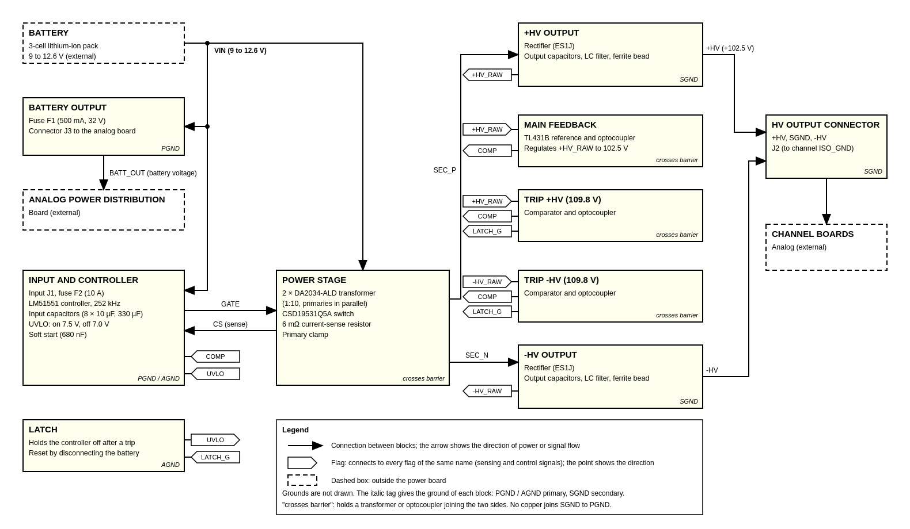

# STIM power board: ±102 V isolated flyback supply

This is the power board for the JY063 multi-channel electrical vestibular stimulator (UBC ELEC 491 capstone, for the UBC Sensorimotor Physiology Laboratory). It turns a three-cell lithium-ion battery into the positive and negative high-voltage rails that the Howland current pumps on the channel board need. It also passes fused battery voltage to the channel board's low-voltage power distribution.

**Status (27 Nov 2026):** schematic complete and checked; layout not started. The design is verified by TI's calculator, LTspice and ngspice only. Nothing has been built or bench-tested.



## At a glance

| Item | Value |
|---|---|
| Input | 9 to 12.6 V, three-cell lithium-ion pack, through a 10 A fuse (F2) |
| Outputs | +102.5 V regulated; −HV follows, 5 to 7 V closer to ground at full load |
| Rated load | 171 mA per rail at 9 V input, sized for 16 channels (requirement 4, goal 8) |
| Topology | One LM51551 controller and one CSD19531Q5A switch driving two Coilcraft DA2034-ALD transformers with primaries in parallel; 252 kHz, continuous conduction |
| Regulation | Secondary side: TL431B reference and optocoupler sensing +HV |
| Protection | Latching over-voltage trip at 109.8 V on each rail; 16.2 A primary current limit; undervoltage lockout on at 7.5 V, off at 7.0 V; primary-side soft start |
| Isolation | Functional (1500 Vrms transformer). The HV return (SGND) is isolated from battery ground (PGND), so the channel board's isolation barrier stays intact |
| Battery feed out | Battery voltage through a 500 mA fuse (F1) to the channel board (J3) |
| Efficiency, ripple | 86.5 % at 9 V and full load; 6 to 7 mV peak to peak after the filter (simulated) |

## Where to start

| If you want to… | Read |
|---|---|
| Understand the board as it is now | [`DESIGN.md`](DESIGN.md): every block, part, value and connection, by schematic designator |
| Know how the design got here | [`context/PROJECT_CONTEXT.md`](context/PROJECT_CONTEXT.md): history, decision log P-1 to P-28, open items, lessons learned |
| Read the reasoning behind a decision | [`context/DESIGN_RATIONALE.md`](context/DESIGN_RATIONALE.md): chronological design log with the principle behind each choice |
| Check the evidence for a number | `sim_ladder/*_RECORD.md`, [`sim_ladder/sheet_benches/README.md`](sim_ladder/sheet_benches/README.md), `calc/*_RECORD.md` |
| Write the course design document | [`docs/design-doc/section5_power_stage_draft.md`](docs/design-doc/section5_power_stage_draft.md): draft of §5 Power Stage |

## Repository map

| Path | Contents |
|---|---|
| `DESIGN.md` | **Current design reference** |
| `pcb/` | KiCad 10 project. `power_supply.kicad_sch` is the top sheet (block diagram); each block is a sub-sheet |
| `pcb/lib/` | Project symbols and footprints (DA2034-ALD, fuse holder) and SPICE models |
| `pcb/tools/` | Netlist and value checks (`check_netlist.py`, `check_values.py`, `intended_netlist.json`) |
| `pcb/power_supply_sim.kicad_sch` | Full-circuit simulation schematic (slow to run) |
| `sim_ladder/` | LTspice checks P6 to P9 with their records, and `sheet_benches/` (ngspice, one bench per sheet) |
| `calc/` | TI LM5155/56 flyback calculator copy and its record |
| `context/` | Project history, decision log and design rationale |
| `docs/` | Block diagram (PNG and SVG) and the course design-document draft |
| `FINAL_DESIGN_FOR_LAYOUT_2026-11-15.md` | Earlier consolidated design (15 to 27 Nov); superseded by `DESIGN.md`, kept for its history |
| `SCHEMATIC_CHANGES_2026-11-14.md` | History: every change from the WEBENCH baseline, with its evidence |
| `JLCPCB_CHECK_2026-11-14.md`, `DA2034_DATASHEET_CHECK_2026-11-14.md` | Part availability and transformer datasheet checks |
| `STIM_Rev1.pdf` | Channel board schematic (reference copy from the channel team) |

## Schematic sheets

| Sheet | Contents | Ground |
|---|---|---|
| INPUT AND CONTROLLER | Battery input J1 and fuse F2, input capacitors, LM51551, UVLO, soft start | PGND, AGND |
| POWER STAGE | Two transformers, switch, sense resistor, primary clamp | Crosses the barrier |
| +HV OUTPUT, −HV OUTPUT | Rectifier, snubber, output capacitors, LC filter, bleeder, transient suppressor | SGND |
| MAIN FEEDBACK | TL431B, cascode, optocoupler, compensation, start-up network | Crosses the barrier |
| TRIP +HV, TRIP −HV | 109.8 V comparator and optocoupler on each rail | Crosses the barrier |
| LATCH | Holds the controller off after a trip | AGND |
| BATTERY OUTPUT | Fuse F1 and connector J3 to the channel board | PGND |
| HV OUTPUT CONNECTOR | J2: +HV, SGND, −HV to the channel board | SGND |
| TEST POINTS | TP1 to TP13 | PGND (TP12), SGND (TP13) |

## Working on the schematic

- Edit the schematic in KiCad. **Do not run `pcb/tools/gen_schematic.py`.** It writes the old flat schematic and would overwrite the hierarchical one.
- After a change, update `pcb/tools/intended_netlist.json`, then run the checks from the `pcb` folder:

  ```
  kicad-cli sch erc power_supply.kicad_sch
  python tools/check_netlist.py      # KiCad's netlist against intended_netlist.json, pin by pin
  kicad-cli sch export bom --fields "Reference,Value,Footprint,LCSC,${DNP}" --labels "Ref,Value,Footprint,LCSC,DNP" --group-by "" --ref-range-delimiter "" -o tools/bom_actual.csv power_supply.kicad_sch
  python tools/check_values.py       # schematic values against the simulation netlist
  ```

  `check_netlist.py` holds the path to `kicad-cli`; edit `CLI` at the top of the file for your machine.
- Log every decision in `context/PROJECT_CONTEXT.md` and reflect it in `DESIGN.md`.
- KiCad files merge poorly. Split work by file or by branch, and merge often.

## Conventions

- Numbers are tagged by source: [DS] datasheet, [calc] TI calculator, [L] LTspice, [N] ngspice, [H] hand calculation, [B] bench, [ASSUME] assumption.
- Decisions are numbered P-n, with date, options, evidence and choice. The channel board uses D-x.
- LTspice and ngspice waveform files are not committed; rerun a netlist or bench to regenerate them.
