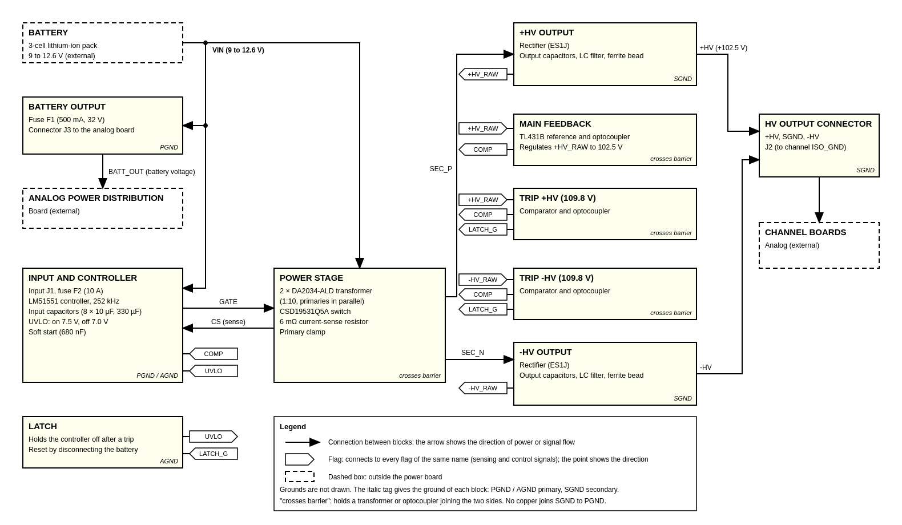

# Draft: Section 5 Power Stage (JY063 Milestone 2 Design)

**Scope.** This draft replaces the introduction to §5 (figures only), §5.2 (Alternatives Considered), §5.3 (Selected Design and Justification) and §5.5 (Implementation Details). §5.1 (Requirements Addressed) and §5.4 (Battery) are not touched and are not reproduced here.

**Sources.** Project records (`FINAL_DESIGN_FOR_LAYOUT_2026-11-15.md`, `context/DESIGN_RATIONALE.md`, `calc/` records, `DA2034_DATASHEET_CHECK_2026-11-14.md`), the KiCad schematic in `pcb/`, your corrections of 27 Nov 2026, the Requirements document and the style guide. Value tags: (simulated) = LTspice; (calculator) = TI LM5155/56 flyback calculator; (datasheet); (hand) = hand calculation.

**Items for the authors are in `[brackets]` and listed again in the notes after the draft.** Delete them before release.

---

## 5 Power Stage: introduction (replacement paragraphs)

The power stage supplies the stimulator's array of Howland current pumps with a positive and a negative high-voltage rail, and passes battery voltage to the analog circuitry's power distribution board. The input to the power supply is a battery, as dictated by C-01.

The power supply delivers ±102.5 V at up to 171 mA per rail. That current serves three loads on each rail:

- **Stimulation current.** Each channel delivers 5 mA at its operating point and 10 mA at its fault limit (NFR-01, NFR-06). The rail voltage must cover a 10 kΩ load at 5 mA (NFR-05, 50 V); we designed for 13 kΩ at 5 mA, which needs 65 V.
- **Auxiliary circuitry current.** Each channel board draws current from the high-voltage rails even when it delivers no stimulation, to run the bias and bootstrap circuits of its Howland pump. Our design basis is about 5.2 mA per rail per channel.
- **Bleeder resistors.** Each channel board discharges its rails through bleeder resistors, about 0.5 mA per rail per channel.

The auxiliary circuitry current is the largest share of the rated load. At 16 channels it is 83 mA of the 171 mA (§5.3.1).

The requirement is 4 channels (FR-01) and the goal is 8 (G-01). We designed the supply for 16 channels (G-03). A smaller channel count only reduces the load, so it does not change the design.

---

## 5.2 Alternatives Considered

We compared alternatives at six decision points. Each subsection states the options, the evidence and the choice. Decision numbers (P-n) refer to the power-supply decision log [R-x].

### 5.2.1 Source of the power stage

Table IX lists the ways we could obtain a ±100 V supply.

**Table IX:** Power-stage alternatives

| Option | Advantages | Disadvantages | Selected? |
|---|---|---|---|
| Inherited open-loop flyback (555 timer) | Already configured | Does not meet target current or voltage | NO |
| Inherited LM3481 flyback | Already partially configured | Incomplete | NO |
| LM51551 flyback (new design) | Lower idle power consumption and footprint, higher gate driving current | Not as easily hand solderable, 1 cent more expensive | YES |
| Off-the-shelf ±100 V module | Less time spent on design, certified operation | Out of budget ($600 for two), not particularly suited to our application, bulky | NO |

### 5.2.2 Topology

We chose an isolated flyback converter over a boost converter. A boost converter cannot isolate, and the flyback is the lowest-part-count isolated topology we found (P-1).

Table X records three further choices that fix how the flyback operates.

**Table X:** Flyback design choices

| Choice | Selected | Alternative | Reason |
|---|---|---|---|
| Conduction mode and frequency | Continuous conduction at 252 kHz with catalogue transformers | Discontinuous conduction at 500 kHz with a custom 0.75 µH transformer | We prioritise off-the-shelf parts (P-11) |
| Rectification | Diodes (non-synchronous) | Synchronous rectification | A synchronous design is less flexible in the choice of MOSFET and costs more |
| Feedback location | Secondary side (sensed directly on the output rails) | Primary-side regulation, which infers the output voltage from the transformer | Primary-side regulation accumulates errors between the output and the measurement, because winding resistance, diode drop and leakage inductance all sit in between. Those errors slow the reaction to a fault in either rail. Sensing the rails directly avoids them, and it holds the setpoint down to zero load (P-1) |

### 5.2.3 Rail tracking

The analog channel board draws current from a bootstrapped stage that needs both rails present. In the analog team's test A7, one rail without the other drives the load: +23 mA with only the positive rail, and −9.7 mA if the positive rail is lost (simulated by the analog team). The two rails must therefore rise and fall together. Table XI compares three ways to achieve this (P-6).

**Table XI:** Rail-tracking alternatives

| Option | Advantages | Disadvantages | Selected? |
|---|---|---|---|
| A. Two independent converters with a shared enable, shared clock and symmetry interlock | Each rail has its own tight loop | One converter can still fail alone, and the interlock must catch it | NO |
| B. One converter, one custom transformer with two secondaries | Both windings share one core flux, so the rails track by construction | Custom part; one switch carries about 12 A peak (hand) | NO |
| C. One converter, two catalogue transformers with primaries in parallel | The rails track by construction; catalogue parts | Unusual arrangement that WEBENCH (TI's design tool) cannot model; the second rail is not directly regulated | YES |

We selected option C. One switch feeds both transformers, which removes the single-converter failure that option A allows. Option C also keeps the off-the-shelf transformer that option B gives up.

### 5.2.4 Isolation

**Table XII:** Isolation alternatives

| Option | Advantages | Disadvantages | Selected? |
|---|---|---|---|
| Reinforced-insulation (medical-grade) transformer | Medical-grade isolation inside the converter | We found no catalogue part with a low-voltage input, a ~110 V output and reinforced insulation (web search, 14 Nov 2026; not exhaustive). Catalogue reinforced flybacks have 5 V or 12 V outputs | NO |
| Functional-isolation catalogue transformer | Catalogue part is available | Provides no patient protection by itself | YES |

Our project does not test on real participants, so it does not require medical-grade isolation. The functional isolation of the selected transformer still matters: it keeps the power supply from bypassing the channel board's isolation barrier (§5.3.5). §5.3.5 also defines the two grades and lists what the lab does to reach medical grade.

### 5.2.5 Output filtering

We compared an inductor-capacitor (LC) filter alone with an LC filter followed by an active capacitance multiplier. The analog team's simulation (test A8) shows rail ripple reaching the load at about 17 µA per volt at 150 kHz. With that figure, the LC filter alone leaves roughly 7 nA at the load (hand). We dropped the capacitance multiplier (P-7).

### 5.2.6 Over-voltage protection

The analog channel is protected by a 111 V diode, and the highest rail in normal operation is 107.9 V (hand). That leaves a window of about 2 V. Table XIII compares two protection actions.

**Table XIII:** Over-voltage protection alternatives

| Option | Result (simulated, 9 V input) | Selected? |
|---|---|---|
| Per-rail clamp that regulates the rail through the controller's compensation pin | The faulted rail overshoots to −114.8 V before settling at −110.7 V | NO |
| Per-rail trip that latches the converter off | The faulted rail peaks at −110.06 V | YES |

A regulating clamp needs high gain to act within 1 V, and a high-gain loop around this power stage is unstable. A trip has no loop to stabilise, so it can act as a fast comparator (P-13).

---

## 5.3 Selected Design and Justification

The power supply is an isolated flyback converter with three deviations from the standard layout. Each deviation removes a failure mode that the stimulator cannot tolerate.

| Deviation | Failure mode removed |
|---|---|
| Two transformers share one switch | One rail alive without the other |
| An independent trip circuit watches each rail | A rail running away when the feedback loop cannot see it |
| The trip latches the converter off until the battery is disconnected | Automatic restart into an unresolved fault |

Figure 4 shows the blocks and the connections between them. The block names match the sheet names in the KiCad schematic.

**Figure 4:** Power supply block diagram

### 5.3.1 Key parameters

**Table XIV:** Power supply parameters

| Parameter | Value | Source |
|---|---|---|
| Input | 9 to 12.6 V (three-cell lithium-ion pack) | §5.4 |
| Regulated rail (+HV) | +102.5 V | P-12 |
| Second rail (−HV) | Follows +HV; at full load it sits 5 to 7 V closer to ground, at −95.8 to −97.4 V | simulated |
| Rated load | 171 mA per rail at 9 V input, sized for 16 channels | P-19 |
| Switching frequency | 252 kHz | calculator |
| Efficiency at 9 V input, 171 mA per rail | 86.5 % (36.4 W in, 31.5 W out) | simulated |
| Battery current at that load | about 4.3 A | simulated |
| Switch peak current at that load | 14.2 A, against a 16.2 A limit | simulated |
| Ripple after the filter | 6 to 7 mV peak to peak | simulated |
| Over-voltage trip | 109.8 V on either rail | hand |

**Load.** The requirement is 4 channels (FR-01) and the goal is 8 (G-01). We designed the power supply for 16 channels (G-03), so a smaller channel count leaves margin and does not change the design.

Part of the rated load is the channels' auxiliary circuitry. Each channel board draws about 5.2 mA per rail with no stimulation, to run the bias and bootstrap circuits of its Howland pump (analog team's test A1, simulated). It also carries a 200 kΩ bleeder resistor, which draws about 0.5 mA per rail. Half the channels source current and half sink it. Table XV scales these figures to each channel count.

**Table XV:** Load per rail by channel count (hand, scaled from per-channel figures)

| Channels | Auxiliary circuitry (idle) | Bleeders | Sourcing channels at the 5 mA operating point | Sourcing channels at the 10 mA fault limit | Total at operating point | Total at fault limit |
|---|---|---|---|---|---|---|
| 4 | 21 mA | 2 mA | 10 mA | 20 mA | 33 mA | 43 mA |
| 8 | 42 mA | 4 mA | 20 mA | 40 mA | 66 mA | 86 mA |
| 16 | 83 mA | 8 mA | 40 mA | 80 mA | 131 mA | 171 mA |

The 16-channel fault-limit total of 171 mA is the rated load. It has no margin on top, only 12 % of current-limit headroom (simulated).

The channel team's latest estimate for the channel board is lower: 3.3 to 3.5 mA per rail per channel including the bleeder (hand calculation, not measured) `[R-y]`. At that figure the fault-limit totals fall to about 34 mA (4 channels), 67 mA (8) and 134 mA (16) (hand). We keep 171 mA as the rated load until the channel team measures the board. `[Update Table XV when the measured idle current exists.]`

### 5.3.2 Two transformers on one switch

The power supply drives two Coilcraft DA2034-ALD transformers from one LM51551 controller and one CSD19531Q5A switch. The two primaries connect in parallel between the battery and the switch node. Each transformer has its own secondary, rectifier and filter: one for +HV and one, reversed, for −HV.

We chose this arrangement because the analog board's test A7 requires both rails to move together (§5.2.3). One switch feeds both primaries, so a single switching event drives both secondaries.

We checked tracking with an idealized model (check P6, 9 V input). The model regulates +HV to 102.0 V and leaves out winding resistance, diode drop and leakage inductance. Table XVI gives the results.

**Table XVI:** Rail voltages, idealized model (simulated, 9 V input)

| Condition | +HV | −HV | Margin to the 110 V channel limit |
|---|---|---|---|
| Both rails idle | 102.0 V | −103.0 V | 7 V |
| +HV loaded 80 mA more than −HV | 102.0 V | −106.2 V | 3.8 V |
| −HV loaded 80 mA more than +HV | 102.0 V | −99.5 V | 9.5 V above the 90 V channel minimum |
| Both rails at 171 mA | 102.0 V | −102.6 V | 7 V |

Start-up and shutdown keep the rails within 2.3 V of each other (simulated).

The model with the real parts, which includes those losses, gives a different full-load result. At 171 mA per rail, −HV sits 5.0 to 6.7 V closer to ground than +HV, between −95.8 V and −97.4 V when +HV is 102.5 V. That range stays above the 90 V channel minimum. We accept this lower rail (P-17); §5.3.3 explains why.

The arrangement has one limit. A feedback loop corrects only the rail it measures. In an early simulation with a 104 V setpoint, the +HV rectifier failed open and −HV rose past −190 V within 10 ms. Tracking does not cover this fault, so each rail has its own trip circuit (§5.3.4).

The DA2034-ALD datasheet gives a primary inductance of 10.0 µH (±10 %), a 1:10 turns ratio and a 10 A rating per transformer. Two primaries in parallel present 5 µH to the controller. At the current limit the worse transformer carries 8.9 A (hand). The sense filter in §5.5.1 adds about 0.6 A, giving about 9.3 A against 10 A. The margin is thin and needs a bench check.

### 5.3.3 Regulation

The controller regulates +HV only. A resistor divider scales the raw rail to 2.495 V, a TL431B reference compares it with its internal 2.495 V, and an optocoupler carries the error to the controller's compensation pin, which sets the peak primary current.

We made three choices in this loop:

- **Cascode transistor.** The TL431 is a 36 V part, and the node it would sit on reaches 54 to 82 V in regulation. A 300 V transistor (MMBTA42) shields the TL431 from the rail (P-2).
- **Compensation values.** TI's calculator gives 12.7 kΩ and 68 nF. With the final output capacitors, the calculator predicts a crossover of 708 to 832 Hz, a phase margin of at least 88° and a gain margin of at least 26 dB across 9 to 12.6 V input (P-14, P-15).
- **Start-up network.** Without it the rail overshoots to 107.4 V and trips the latch at 15.5 ms. With it the rail settles without overshoot (simulated). The network is mandatory.

The calculator has no model for two transformers on one switch, so we entered the equivalent single supply: 102 V at 0.43 A through one 5 µH primary. Every calculator check passes with this entry once we raised three values: output capacitance, soft-start capacitor and slope-compensation resistor [R-x].

The second rail is not regulated directly. Winding resistance, diode drop and leakage inductance subtract from the rail the loop does not watch, which is why −HV sits 5 to 7 V lower at full load. A Howland current pump sets its current from the command and its sense resistor, so the rail voltage matters only when a channel reaches its voltage limit. Sinking channels lose 5 to 7 V of reach, about 1.2 kΩ of load at 5 mA (hand). They still cover the analog team's 5 mA into 13 kΩ, which needs 65 V, with a rail as low as 90 V.

### 5.3.4 Protection

**Over-voltage trip.** Each rail has an independent trip block. The block uses a TL431B as a comparator with its threshold at 109.8 V. With 0.5 % references and 0.1 % resistors the threshold spans 109.0 to 110.6 V (hand), above the highest normal rail (107.9 V) and below the channel's 111 V diode. When a rail crosses the threshold, one optocoupler current does two jobs. It pulls the controller's compensation pin low, which stops the next switching cycle, and it fires a latch across the controller's undervoltage-lockout (UVLO) pin. The battery holds the latch, so only disconnecting the battery resets it. The default state after a fault is off.

In simulation (check P8, 9 V input) the faulted rail peaks at −110.06 V. The trip acts in 0.48 ms when the +HV rectifier opens, and in 1.13 ms when the main optocoupler opens. The trip does not fire at the worst normal load imbalance. After a trip both rails decay together, which avoids the single-rail condition of test A7. `[FR-11 asks the device to show which fault stopped it. State how the trip is indicated.]`

**Other protective measures.**

**Table XVII:** Other protective measures

| Measure | Value | Purpose |
|---|---|---|
| Primary current limit with hiccup restart | 16.2 A (6 mΩ sense resistor); the LM51551 stops for 32,768 cycles after 64 cycles at the limit | Bounds the energy in the transformers on overload or output short |
| Input UVLO | on at 7.5 V, off at 7.0 V | Turns the converter off below 7.0 V; the battery terminal sags to 8.47 V at full load (simulated), 1.4 V above the turn-off threshold |
| Primary-side soft start | 680 nF | Limits start-up current: transformer peaks of 8.0 and 8.6 A, no cycle at the current limit, regulation reached in 54 ms (simulated; the model's regulated rail reads about 2 V low, so it reaches 100 V) |
| Transient suppressor on each raw rail | SMBJ130A (130 V standoff) | Backstop for fast spikes only; it cannot survive a sustained fault |

The soft-start value sits between two tested failure modes: 220 nF reaches the current limit by 16 ms, and 1 µF overshoots by 3.7 V. A ±10 % capacitor spans 612 to 748 nF, which stays between those tests.

Battery discharge protection is outside this document. The next design document covers it.

The supply's current limit does not protect the participant, because the supply can deliver more than 100 mA at over 100 V. Per-channel hardware current limiting on the analog board does that job (FR-12, C-04).

### 5.3.5 Isolation

**Functional isolation** separates two circuits so that the equipment works. It keeps one circuit's voltage and noise out of the other. It makes no claim to protect a person from electric shock. The DA2034-ALD transformer provides this grade: 1500 Vrms for one minute, with 128 pF between windings (datasheet).

**Medical-grade isolation** protects a person who is connected to the equipment. Standard IEC 60601-1 sets it for patient-connected equipment. It requires reinforced insulation, which stays safe after a single fault. It also sets a higher test voltage, minimum creepage and clearance distances, and limits on the leakage current that reaches the patient. Typical values are around 4 kV test voltage and 8 mm creepage. `[Confirm these values against the standard before release.]`

Our project does not test on real participants (C-06: tests on resistor loads and a phantom), so the power supply provides functional isolation only.

**System isolation barrier.** The channel board separates its participant side from its FPGA side with a 7.0 mm isolation barrier. Digital isolators carry the control signals across it, and an isolated DC-DC converter powers its low-voltage circuits from the battery [R-y]. The battery feed (VBAT) enters on the FPGA side; the high-voltage rails and their return (ISO_GND) sit on the participant side.

The power supply keeps that barrier intact with two grounds:

| Ground | Side | Connects to |
|---|---|---|
| PGND (with AGND, joined at one net tie) | Primary: battery, controller, switch, latch | Battery negative; the channel board's VBAT return through J3 |
| SGND | Secondary: rectifiers, output filters, feedback reference, trip blocks | The channel board's ISO_GND through J2 |

No copper joins SGND to PGND. Only the two transformers and the three optocouplers (main feedback and both trip blocks) cross between them. All secondary circuits draw their power from the high-voltage rails, so the secondary side needs no supply from the primary side.

One battery feeds both boards, so the power supply's crossing sits in parallel with the channel board's barrier. The system barrier is only as strong as the weaker of the two. At the transformer, the secondary pin sits 4.73 mm (pad edge to pad edge) from the nearest primary pin on the footprint, with an unconnected pin between them. That is less than the channel board's 7.0 mm.

The design keeps a path to medical-grade isolation. It uses a catalogue transformer, so the lab can swap or re-qualify that single part. Three steps remain before the lab uses the stimulator on a participant:

1. **Coilcraft's approval.** The DA2034 datasheet restricts use in medical applications without Coilcraft's approval. The lab requests it.
2. **Insulation verification.** Approval does not make the part reinforced. The records do not show that the DA2034-ALD or the TCMT1108 optocouplers meet the reinforced requirement of IEC 60601-1. The lab checks their insulation, creepage and clearance against the standard, and replaces any part that falls short.
3. **Leakage current.** The two transformers couple 128 pF each between primary and secondary (datasheet). The lab measures the leakage current that reaches the participant side against the standard's limit.

`[FR-10 reads "The power supply current and EMR are isolated from the patient", and §5.1 says the isolated flyback addresses FR-10. Reword one of them to match this subsection.]`

### 5.3.6 Battery feed to the analog power distribution board

The power supply sends battery voltage directly to the analog circuitry's power distribution board through a fused connector. The schematic places fuse F1 (500 mA, 32 V, 1206 package) in series with connector J3, both fed from VIN. `[F1 and J3 are marked as placeholders in the schematic. Confirm the fuse rating against the analog board's current draw, which is not yet known.]`

The channel team estimates that the channel board draws about 0.13 A at 9 V from this feed (hand calculation, assuming 65 % converter efficiency, not measured) `[R-y]`, against the 500 mA fuse. The analog board therefore receives the battery voltage, 9 to 12.6 V, with no regulator in between. The feed does not pass through the lockout or the trip latch, so the analog board stays powered after a trip. `[Optional: state why the 9 V regulator was dropped.]`

### 5.3.7 Basis of the figures

The performance figures above come from TI's calculator, LTspice and hand calculation. Four caveats apply:

- The reference model in the final simulation turns on softly, so the regulated rail reads about 2 V low there (100.35 V instead of about 102.5 V). Trip-level margins rest on check P8.
- Check P8 used an earlier compensation and a weaker optocoupler. A re-run with the final values stalled in the solver and was stopped.
- The simulation has no transformer saturation. It also omits the loss from the DA2034-ALD's 128 pF interwinding capacitance, which we estimate at 0.5 to 1 W per transformer (hand).
- Measured values belong in the validation document. `[Update this subsection when bench results exist.]`

---

## 5.5 Implementation Details

This section lists the key parts and values. Appendix A holds the full bill of materials (BoM), with reference designators and JLCPCB part numbers. Reference designators are omitted here because the schematic's designators are authoritative. `[Confirm the schematic is final before citing designators.]`

### 5.5.1 Controller and primary side

**Table XVIII:** Primary-side parts

| Function | Part and value | Reason |
|---|---|---|
| Controller | LM51551DSSR | Has the hiccup current limit that the LM5155 lacks (datasheet) |
| Switching frequency | 86.6 kΩ timing resistor, giving 252 kHz | Calculator gives 87.45 kΩ for 250 kHz |
| Switch | CSD19531Q5A, 100 V, 6.0 mΩ typical (7.8 mΩ maximum) at 6 V gate drive | Carries about 6.7 A RMS; conduction loss 0.27 to 0.35 W (hand); in the JLCPCB library |
| Transformers | Two Coilcraft DA2034-ALD: 10 µH, 1:10, 10 A | Catalogue part; not in the JLCPCB library, so bought separately and hand-soldered (P-24) |
| Current-sense resistor | 6 mΩ, 1 %, 3 W | Sets the 16.2 A limit; dissipates 0.24 W (simulated) |
| Slope-compensation resistor | 200 Ω | Duty exceeds 50 %; the calculator requires 191 Ω and fails with 0 Ω |
| Sense filter capacitor | 2.2 nF | At 470 pF the controller skips a pulse every 5 to 6 cycles; at 2.2 nF switching is regular (P-16). The limit acts about 0.35 µs later, which lets the current run about 0.6 A past the limit (hand) |
| Undervoltage lockout | 49.9 kΩ and 12.4 kΩ, giving on at 7.5 V and off at 7.0 V | P-18 |
| Soft start | 680 nF capacitor with a PNP transistor clamping the compensation pin | P-20 |
| Input capacitors | Eight 10 µF ceramics (25 V) plus one 330 µF electrolytic | The ceramics carry about 0.6 A RMS each; the electrolytic damps resonance with the battery lead. Input ripple is 0.21 V peak to peak (simulated). Polymer parts had no stock |
| Primary clamp | 100 V, 5 A Schottky diode and three 300 Ω, 2 W resistors in parallel | Dissipates the transformers' leakage energy: 1.3 W in simulation, up to 4.5 W estimated |

### 5.5.2 Output side (per rail)

**Table XIX:** Output-side parts

| Function | Part and value | Reason |
|---|---|---|
| Rectifier | ES1J, 600 V, 1 A, with an RC snubber (220 Ω and 22 pF as start values) | The rectifier sees 389 V reverse at 9 V input and 470 V at 12.6 V (simulated); the snubber is tuned on the bench |
| Bulk capacitance | Three 10 µF, 200 V electrolytics plus one 1 µF, 250 V ceramic | 62 µF total across both rails, above the calculator's 55 µF minimum. A single 33 µF part is thinly stocked |
| Filter | 100 µH inductor, ferrite bead, 1 µF ceramic, plus a 10 µF and 10 Ω damping branch | Ripple falls from 85 to 93 mV to 6 to 7 mV peak to peak (simulated). The loop senses the rail before the filter, so the filter cannot destabilise it |
| Transient suppressor | SMBJ130A | See §5.3.4 |
| Feedback divider (+HV only) | Three 33.2 kΩ (0.1 %) in series on top, 2.49 kΩ (0.1 %) on the bottom | Sets 102.5 V; the series string shares the voltage. The calculator gives 2.497 kΩ |
| Trip divider | Same top string, 2.32 kΩ bottom | Sets 109.8 V |

### 5.5.3 Transformer

We use the DA2034-ALD datasheet values below (Coilcraft Document 510, revised 7 March 2025).

**Table XX:** DA2034-ALD parameters (datasheet)

| Parameter | Value |
|---|---|
| Primary inductance | 10.0 µH ±10 %; at least 9.0 µH at 10 A |
| Turns ratio | 1:10 |
| Maximum winding resistance | 0.018 Ω primary, 1.75 Ω secondary |
| Maximum leakage inductance | 0.250 µH |
| Interwinding capacitance | 128 pF |
| Isolation | 1500 Vrms for one minute |
| Intended use | 3 to 24 V input, 300 V output |

Each part has four primary windings, which we join on the board: pins 7 to 10 to the battery, pins 3 to 6 to the switch node. The footprint comes from LCSC's EasyEDA data. `[Cross-check the pin numbers and footprint against Coilcraft's drawing before ordering.]`

### 5.5.4 Layout rules

- Keep the loop of input capacitors, primaries, switch and sense resistor as small as possible; it carries 14 A pulses.
- Route both transformers to the switch node and the battery with equal trace lengths; the transformers ring against each other through their leakage inductance.
- Place the sense filter next to the controller.
- Follow JLCPCB's rules, then add extra clearance on the rectifier nodes (up to 470 V) and the raw rails (205 V apart), because the rules are manufacturing minimums and not voltage clearances.
- Keep the reference pins, feedback nodes and latch gate away from the switch node and the rectifier nodes.
- Split the ground pours into a primary region (PGND and AGND) and a secondary region (SGND). Keep a gap between them on every copper layer, crossed only by the two transformers and the three optocouplers, with no tracks, vias or pours in it. Make the gap as wide as those parts allow.
- Measure the high-voltage rails against the SGND test point and primary nodes against the PGND test point. A probe ground on the wrong test point bridges the barrier.

### 5.5.5 External connections

**Table XXI:** Connectors

| Connector | Carries | Ground | Goes to |
|---|---|---|---|
| J1 (through fuse F2, 10 A, 32 V) | Battery input, 9 to 12.6 V | PGND | Battery |
| J3 (through fuse F1, 500 mA, 32 V) | Battery voltage, 9 to 12.6 V | PGND | Analog power distribution board (channel board VBAT, FPGA side) |
| J2 | +HV, SGND, −HV | SGND | Analog channel boards (HV input, ISO_GND side) |

`[Both connectors are placeholders in the schematic. Confirm pin-outs with the analog-board owner.]`

---

## References to add `[merge with the document's reference list]`

- `[R-x]` Power-supply decision log P-1 to P-25 and records (`context/DESIGN_RATIONALE.md`, `calc/CALC_RECORD_2026-11-14.md`, `sim_ladder/` records P6, P8, P9).
- Texas Instruments, LM5155/LM51551 datasheet (SNVSB75E).
- Coilcraft, Document 510, DA2032/2033/2034 (revised 7 March 2025).
- Vishay, TCMT1100 series datasheet (83510).
- Texas Instruments, TL431 datasheet; CSD19531Q5A datasheet.
- Analog board records: tests A1, A7, A8; FMEA row F04.
- `[R-y]` Channel board repository, `02_rev1_channel/PWR_Rev1/README.md` (load current estimates) and `README.md` (block diagram, isolation barrier), snapshot of 25 Nov 2026, https://github.com/WeymenKoo/Capstone-Stimulator-Channel

## Acronyms to add `[to the document's acronym table]`

DAC (digital-to-analog converter), FPGA (field-programmable gate array), LC (inductor-capacitor), UVLO (undervoltage lockout), BoM (bill of materials), HV (high voltage).
